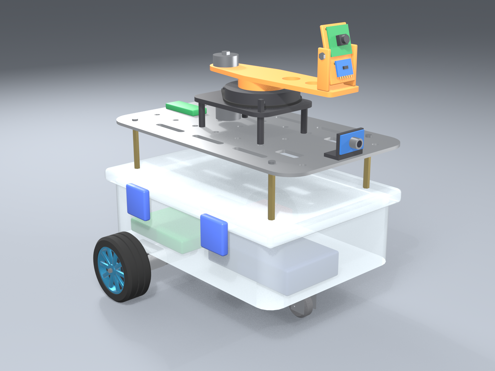
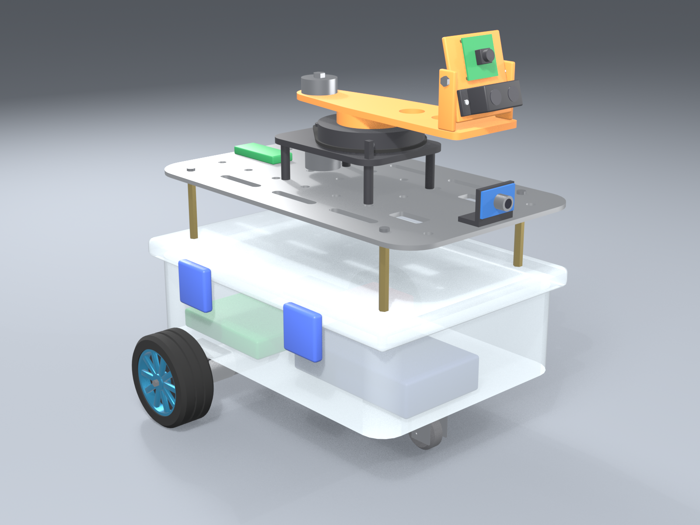

# 3D scanner proof of concept

The RPLIDAR A1's ranging head has died, but its base, motor, belt and turntable
still work. This PoC reuses them to spin a camera (and optionally a single-point
ToF) **off-axis**, so each revolution captures a ring of views from a circle of
known size. That known size is what makes the 3D map metric.

| VL53L1X variant (cheap, buildable now) | TFmini-S variant (if funding allows) |
|---|---|
|  |  |

Models: [`model/build_scanner_model.py`](../model/build_scanner_model.py) builds
`model/firefighter_scanner_vl53l1x.blend` and `model/firefighter_scanner_tfmini_s.blend`.
Rebuild and re-render with:

```bash
blender --background --python model/build_scanner_model.py
blender --background model/firefighter_scanner_vl53l1x.blend --python model/render_firefighter_model.py
blender --background model/firefighter_scanner_tfmini_s.blend --python model/render_firefighter_model.py
```

## Why off-axis

A camera spinning about its own optical centre sees the room from one point:
there's no parallax, so it can't triangulate and depth has no scale. Mounting it
at radius `r` from the spin axis gives every pair of frames a metric stereo
baseline (up to `2r`), fixed by a tape measure rather than by a neural network.

Depth error σz ≈ z²·σd / (f·b), with f ≈ 600 px and σd ≈ 0.5 px:

| r (baseline up to 2r) | 1 m | 3 m | 5 m |
|---|---|---|---|
| 8 cm | ~0.5 cm | ~4.7 cm | ~13 cm |
| **10 cm (this PoC)** | ~0.4 cm | ~3.8 cm | ~10 cm |
| 15 cm | ~0.3 cm | ~2.5 cm | ~7 cm |

## The rig

| Part | What it is | Model link |
|---|---|---|
| A1 base, motor, belt | Kept from the dead LiDAR, on the existing standoffs | `scanner_base` (fixed) |
| Turntable + printed hub + arm | The A1 ranging core is unbolted; a printed hub bolts to the turntable | `scanner_rotor` (continuous, Z) |
| Counterweight | Washers/nuts on the far end of the arm, ~40 g; trim until the arm stays put at any angle | `scanner_rotor` |
| Sensor head | Printed plate pivoting on an M3 bolt between two ears; tilt adjustable, 15° up | `scan_head` |
| Camera | Raspberry Pi Camera Module 3 Wide (assumed; swap in your camera's size) | `scan_camera`, origin at lens |
| ToF | VL53L1X carrier or TFmini-S, under the camera and parallel to its axis | `scan_tof`, origin at beam exit |
| Index | Magnet on the turntable rim, hall sensor (A3144 or similar) on a post at −45° | base + rotor |

Key numbers (in `build_scanner_model.py`): `CAMERA_RADIUS = 0.10 m`,
`TILT_DEG = 15`, camera lens at about z = 0.26 m. The real `r` and tilt come
from calibration, not from these values.

**Cable:** a CSI ribbon can't go through a slip ring, so the rotor **sweeps
back and forth** instead of spinning continuously. It starts at the index pulse,
goes forward until the next pulse (360°), carries on about 20° by time for
overlap, then reverses. A loose cable wrap around the hub takes about 1.1 turns.
The ToF wires (4 conductors) run alongside the ribbon.

**Motor drive:** the A1 motor is a bare DC motor. Reversing it needs an
H-bridge, for example a DRV8833 on a spare PWM pin of the ESP32 or the Pi. Run it
slowly, at about 20 s per revolution. The motor is weak, so balance the arm
before blaming the drive.

## VL53L1X vs TFmini-S: sampling speed is not the bottleneck

At PoC scan speed (one revolution in about 20 s, 18°/s):

| | VL53L1X | TFmini-S |
|---|---|---|
| Rate | ~50 Hz short mode; ~30 Hz long mode (≥33 ms timing budget) | up to 1000 Hz (100 Hz default) |
| Angular spacing at 18°/s | **0.4–0.6°** (600–900 points/rev) | 0.02–0.18° |
| Beam | **~27° cone** at full SPAD array; narrower with a smaller ROI (less signal) | **~2°** |
| Spot at 3 m | ~1.4 m wide at full array | ~10 cm |
| Range indoors | up to ~4 m in long mode in the dark; much less in bright ambient light | 0.1–12 m |
| Interface / power | I²C, 3.3 V | UART (or I²C), 5 V |
| Price | low | several times higher |

**Takeaway:** at 20 s per revolution the VL53L1X already gives a reading about
every half degree, which is plenty to anchor scale. Its real weakness is the
**wide cone**, which blurs a whole patch of wall into one distance. The PoC
handles that like this:

1. Set the smallest ROI the signal allows, and measure the actual cone angle at
   the bench.
2. Model each reading as the depth over the cone's footprint in the camera
   image, not as a single pixel.
3. Keep only readings where the dense depth inside that footprint is nearly
   planar (low variance): walls, floor, cabinet faces. Drop readings at edges and
   corners.

The TFmini-S's narrow beam makes nearly every reading usable and reaches across
large rooms. That's the upgrade path, not a requirement for the PoC. Because the
two models only differ in the ToF, the software treats the sensor as one
parameter: cone angle, rate and range.

## Pipeline (from the design)

```
[drive]──odom (optical flow + IMU)──►[stop]──►[scan station]──►[register]──►[global map]
```

**Per station (on the Pi)**
1. Sweep and capture 24–36 frames per revolution with a short exposure. Log the
   ToF continuously, and timestamp hall pulses, frames and ToF readings on one
   clock.
2. Pose prior: the camera sits on a circle of known radius `r` at tilt `t`;
   angle θ comes from the index plus timing.
3. Match features (XFeat) between neighbouring frames and the next-but-one.
4. Run a constrained bundle adjustment over **θ per frame only**, with `r`, tilt
   and intrinsics fixed. This locks the scale.
5. Triangulate sparse metric points.
6. Dense depth: Depth Anything V2 Small (metric-indoor) per frame. Fit a scale
   and shift per frame with a robust fit against the triangulated points and the
   ToF readings (ToF weighted higher where it passes the planarity check).
7. Reject pixels that disagree between neighbouring frames (glass, mirrors,
   blank walls), then fuse into an Open3D TSDF at 2–4 cm voxels.

**Between stations**
- Odometry prior from the optical flow sensor and the IMU. Optical flow needs
  height above the floor for scale: use the fixed mount height, or a ToF.
- Point-to-plane ICP between overlapping station clouds.
- Loop closure, then a GTSAM pose graph.
- Outputs:
  - a TSDF mesh or OctoMap;
  - a 2D slice on `/map` for Nav2;
  - the ToF ring as a coarse `LaserScan`, so slam_toolbox keeps working.

**Optional off-board:** send frames, poses and sparse points to a laptop and run
MapAnything, which accepts intrinsics, poses and sparse depth as inputs. Check its
output against the triangulated points.

**Limitation:** cameras fail in smoke. For a fire scene, map early and localise
against that map.

## Calibration

1. Camera intrinsics with a checkerboard (OpenCV).
2. Rig extrinsics (`r`, tilt): sweep in front of a fixed checkerboard and fit the
   circle. **This is the scale; measure it carefully.**
3. ToF-to-camera offset: aim the dot (TFmini-S) or the cone centre (VL53L1X) at
   a target board.
4. VL53L1X: measure the actual cone at your ROI setting against a wall edge.

## PoC milestones

| # | Milestone | Done when |
|---|---|---|
| 1 | Print and assemble the rig, balance the arm, drive the motor through an H-bridge, read the hall index | Repeatable sweeps; index pulse every revolution |
| 2 | Synchronised logging of camera frames, ToF and index on the Pi | One ROS bag per sweep, timestamps aligned |
| 3 | Calibration (above) | `r` known to ±1 mm, tilt to ±0.2° |
| 4 | Single-station sparse triangulation with θ-only bundle adjustment | Tape-measured distances within 3 cm at 3 m |
| 5 | Dense depth with scale/shift alignment, TSDF fusion | Mesh of one room corner; flat walls stay flat |
| 6 | VL53L1X anchoring | Scale error with ToF lower than without |
| 7 | Multi-station ICP and pose graph | Whole-room map; loop closes within 5 cm |

## After the PoC (if funded)

Swap the ToF for a TFmini-S. That's a drop-in on the same head; only `scan_tof`
changes. After that:
- an encoder or stepper on the rotor;
- a Pi Zero 2 W on the rotor with a power-only slip ring, for continuous spinning
  with frames sent over Wi-Fi;
- a global-shutter camera;
- a Hailo AI HAT+ for faster on-board depth.
